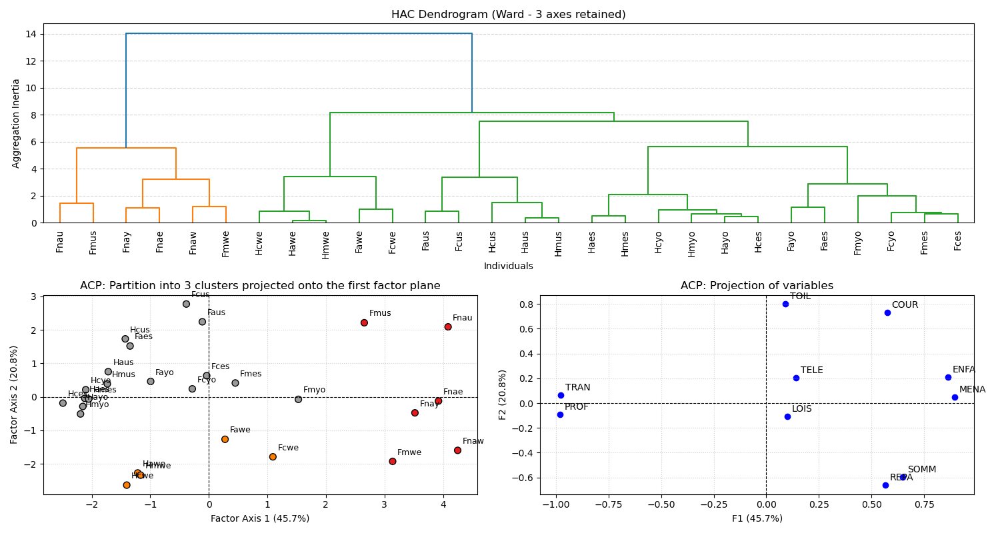

# Multivariate analysis & clustering (PCA, MCA, HAC, k-means)

PCA and MCA (multiple correspondence analysis) implemented **from the general
factor-analysis formulation** (data matrix `X`, weight matrix `D`, metric `M`),
combined with hierarchical agglomerative clustering (HAC) and k-means run on the
factor scores. Python / NumPy / SciPy / Matplotlib.

The only linear-algebra routine used is `numpy.linalg.eig`: there is no call to
`sklearn.decomposition`, `PCA` or `prince`.

> Coursework for the *Data Analysis and Pattern Recognition* module
> (Centrale Lyon, 2026). Course notes and the written report are in French;
> code comments are in English.

## Dataset

`data/population_*.txt`: time-use data for **28 population categories** described by
**10 activities** (paid work `PROF`, transport `TRAN`, housework `MENA`, childcare
`ENFA`, shopping `COUR`, personal care `TOIL`, meals `REPA`, sleep `SOMM`, television
`TELE`, leisure `LOIS`). Supplied with the course.

## What the code does

| Step | Function | Notes |
|---|---|---|
| Load data | `readfile` | |
| Equal-frequency binning | `discretization` | turns quantitative variables into `n` categories for MCA |
| PCA / MCA | `factor_analysis` | builds `X`, `D`, `M`; eigendecomposition of `XᵀDXM`; factor scores, % inertia, contributions, squared cosines |
| HAC | `cah` | on the first `n_axes` factor axes; Ward (default) or complete linkage |
| k-means | `k_means` | on the first `n_axes` factor axes |

Clustering is run on the first 3 factor axes only, on the assumption that the
remaining axes mostly carry noise.

## Run it

```bash
pip install -r requirements.txt

python src/analysis.py                                         # PCA + HAC (Ward)
python src/analysis.py --analysis acm --clustering k-means     # MCA + k-means
python src/analysis.py --analysis acp --clustering cah --linkage complete
python src/analysis.py --analysis acm --clustering none        # factor planes only
```

Options: `--analysis {acp,acm}` (`acp` = PCA, `acm` = MCA), `--clustering {cah,k-means,none}`
(`cah` = HAC), `--linkage {ward,complete}`, `--n-clusters N`.

## Example output

PCA followed by Ward HAC. The first two axes carry 45.7 % and 20.8 % of the inertia;
paid work and transport (`PROF`, `TRAN`) load on the opposite side of axis 1 from
housework, childcare, meals and sleep.



All eight combinations (PCA/MCA × none/Ward/complete/k-means) are in
[`docs/figures/`](docs/figures). The full analysis and comparison of the methods is in the
[written report (French)](report/factor-analysis-clustering-report-fr.pdf).

## Limitations

- Results are shown for a single small dataset (28 individuals); no stability
  analysis of the clusters across random seeds is provided for k-means.
- The number of clusters is fixed by hand (default 3), not chosen by a criterion.
- Plots are displayed interactively (`plt.show()`); figures in `docs/figures` were
  saved from those windows.

## Credits

Course module and dataset: Centrale Lyon. Implementation, experiments and report:
Ethan Bocquet.

## License

[MIT](LICENSE)
